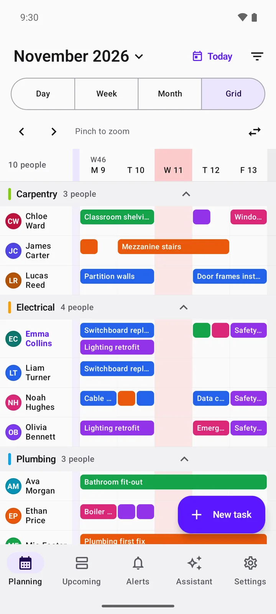
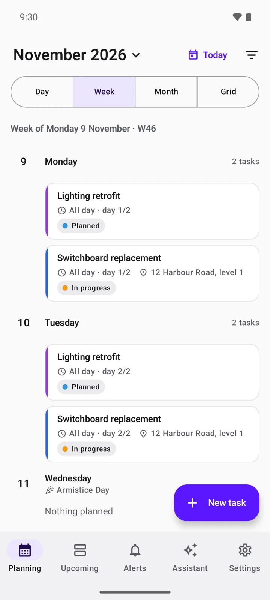
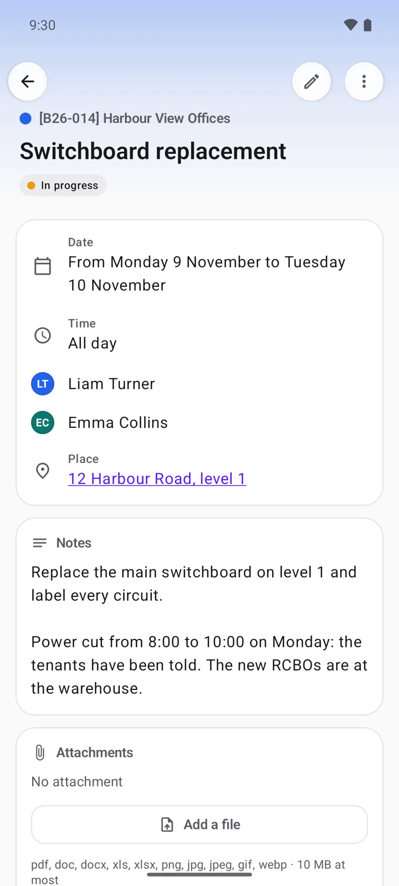
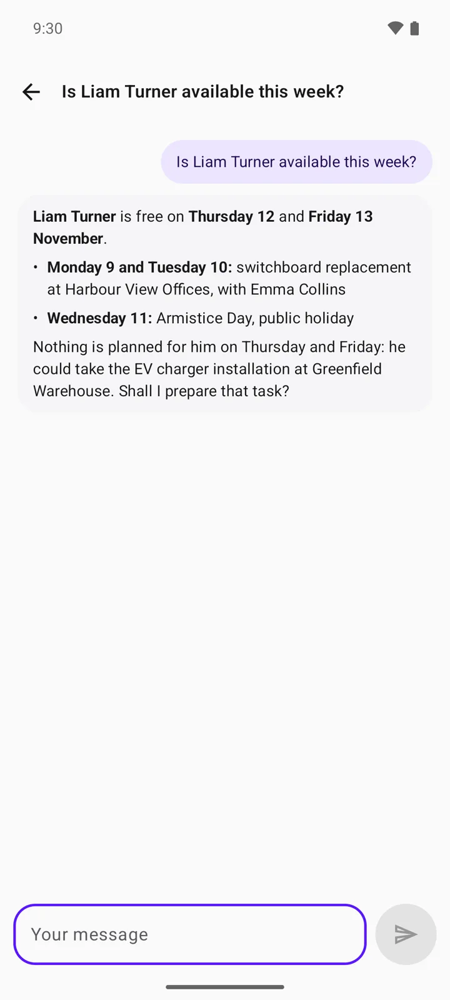
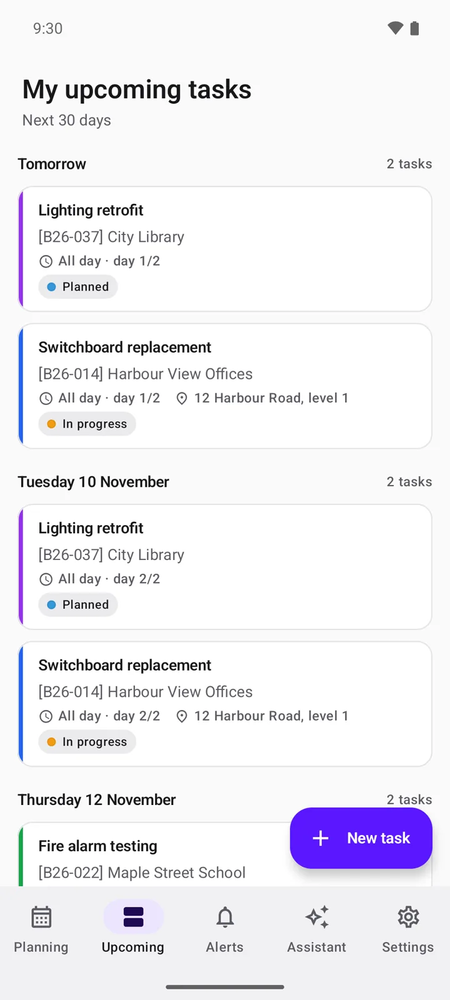
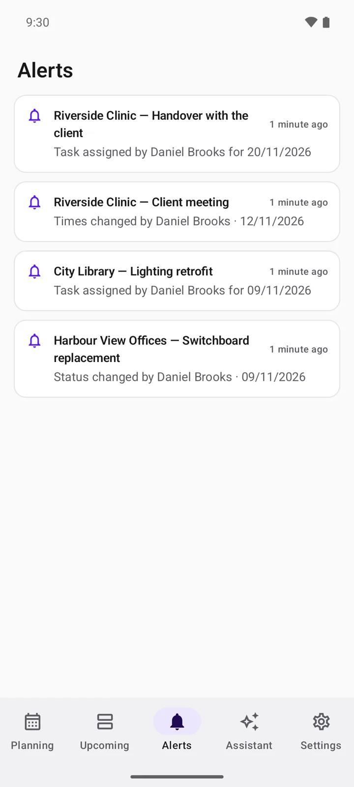
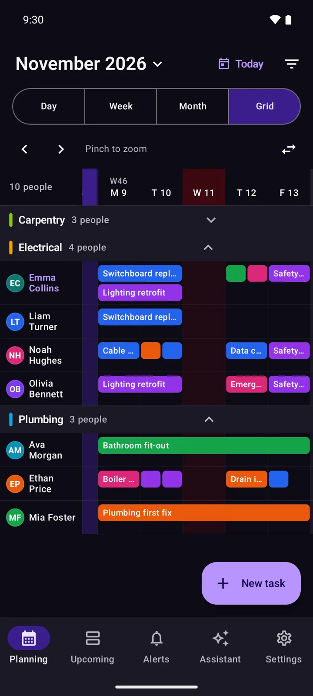
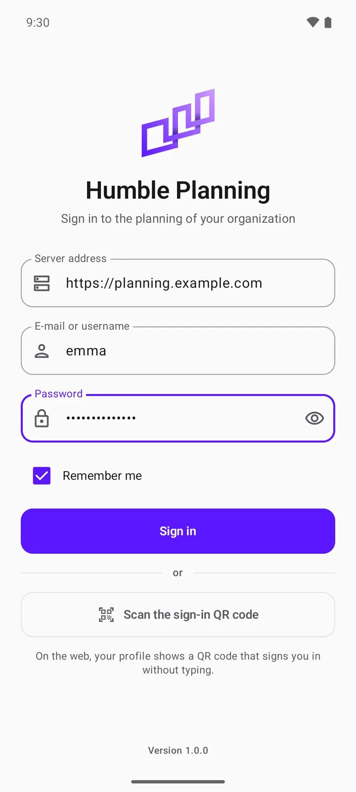

<p align="center">
  <a href="https://humbleplanning.com/">
    <picture>
      <source media="(prefers-color-scheme: dark)" srcset="docs/branding/logo-dark.png">
      
    </picture>
  </a>
</p>

<h3 align="center">Your team's schedule, in your pocket.</h3>

<p align="center">
  The native Android app of <a href="https://github.com/Malfhas/HumblePlanning">Humble Planning</a>, the open-source scheduling application for field teams.<br>
  It connects to your own Humble Planning server: your data never goes anywhere else.
</p>

<p align="center">
  <a href="https://humbleplanning.com/"><strong>Website</strong></a> ·
  <a href="https://github.com/Malfhas/HumblePlanning"><strong>Server</strong></a> ·
  <a href="https://github.com/Malfhas/HumblePlanning-Android/releases/latest"><strong>Download</strong></a> ·
  <a href="#installing"><strong>Installing</strong></a> ·
  <a href="CHANGELOG.md"><strong>Changelog</strong></a>
</p>

<p align="center">
  <a href="LICENSE"></a>
  <a href="https://github.com/Malfhas/HumblePlanning-Android/releases/latest"></a>
  
  
  
</p>

<p align="center"><sub>A project by <a href="https://indumia.com/"><strong>Indumia</strong></a></sub></p>

---

<p align="center">
  <a href="#a-quick-tour">Tour</a> ·
  <a href="#features">Features</a> ·
  <a href="#installing">Installing</a> ·
  <a href="#connecting-to-your-server">Server</a> ·
  <a href="#development">Development</a> ·
  <a href="#contributing">Contributing</a> ·
  <a href="#license">License</a>
</p>

## A quick tour

<table>
  <tr>
    <td width="25%" valign="top">
      <a href="docs/screenshots/grid.webp"></a>
      <p><strong>The team grid.</strong> Everyone on one schedule, team by team, like on the web: pinch to zoom, tap a task to open it, tap an empty day to plan someone.</p>
    </td>
    <td width="25%" valign="top">
      <a href="docs/screenshots/week.webp"></a>
      <p><strong>Day, week and month.</strong> Your own tasks or anyone's, with public holidays, half days, statuses and places.</p>
    </td>
    <td width="25%" valign="top">
      <a href="docs/screenshots/task.webp"></a>
      <p><strong>Every detail of a task.</strong> Dates, people, place on the map, notes and attachments; edit it when your role allows it.</p>
    </td>
    <td width="25%" valign="top">
      <a href="docs/screenshots/assistant.webp"></a>
      <p><strong>The AI assistant.</strong> Ask about the schedule in plain language. Any change it prepares waits for your approval.</p>
    </td>
  </tr>
  <tr>
    <td width="25%" valign="top">
      <a href="docs/screenshots/upcoming.webp"></a>
      <p><strong>What's next.</strong> Your tasks of the next 30 days, readable offline.</p>
    </td>
    <td width="25%" valign="top">
      <a href="docs/screenshots/alerts.webp"></a>
      <p><strong>Alerts.</strong> Told as soon as someone changes one of your tasks, even when the app is closed.</p>
    </td>
    <td width="25%" valign="top">
      <a href="docs/screenshots/grid-dark.webp"></a>
      <p><strong>Light and dark.</strong> Follows the phone, or your choice, with the colours of your wallpaper if you like.</p>
    </td>
    <td width="25%" valign="top">
      <a href="docs/screenshots/sign-in.webp"></a>
      <p><strong>Your server, your account.</strong> Sign in with your password and second factor, or scan the QR code of your web profile.</p>
    </td>
  </tr>
</table>

<p><sub>The screenshots use invented people and worksites. The app is available in English, French, Spanish and German.</sub></p>

## Features

| Area | Highlights |
| --- | --- |
| **Planning** | Day, week and month views, and a team grid like the web schedule (pinch to zoom, collapsible teams); filters by person, team, project and status; public holidays; live updates as your team changes the schedule |
| **Tasks** | Create and edit tasks with several people, half days or hours, recurrence, places, resources, notes and attachments; locked tasks stay read-only |
| **Alerts** | Real-time alerts when someone changes one of your tasks, which each user can turn off; reminders before a task starts |
| **AI assistant** | The assistant of your server, with its model and permissions; every change waits for your approval; the gauge of your monthly quota, and its reset date once it is used up |
| **Offline** | Your own tasks stay readable without a network, encrypted on the phone |
| **Sign-in** | Password, second factor, or the QR code of the web profile; sessions listed and revocable from the web and from the app |
| **Security** | HTTPS only, data on the phone encrypted with the Android Keystore and excluded from backups, the server's permissions on every request |
| **Devices** | Phones and tablets, light and dark themes, Material You colours, English, French, Spanish and German |

## Installing

Download `humbleplanning-<version>.apk` from the [latest release](https://github.com/Malfhas/HumblePlanning-Android/releases/latest) and open it on the phone (Android 8.0 or later). Android asks once to allow installing apps from your browser or file manager.

To be told of new versions, add this repository to [Obtainium](https://github.com/ImranR98/Obtainium). Every release is signed with the same key, so a new version installs over the old one and keeps your settings.

Each release comes with a `.sha256` checksum. The signing certificate of every APK has this SHA-256 fingerprint, which `apksigner verify --print-certs` shows:

```
D5:A0:03:F6:E0:B3:93:79:06:EF:CB:59:25:15:1F:07:DF:61:9E:2D:A3:AE:36:98:BC:64:BB:6C:90:24:76:47
```

## Connecting to your server

The app needs a [Humble Planning](https://github.com/Malfhas/HumblePlanning) server that includes the mobile API (`/api/mobile`). Ask your administrator for its address, or sign in by scanning the QR code shown in your web profile.

The server decides what each account may do: the app follows the same permissions as the web, and a role needs the "Use the mobile app" permission. Administrators set the options under *Settings → Security → Mobile app*: sign-in, QR codes, alerts, the minimum app version and the page an outdated app opens to update.

**Push notifications.** A push only wakes the app up: it carries an alert id, and the app reads the alert from your server, so no planning data goes through Google. A server reaches the app through its own Firebase project, or through the push relay of the published app (`deploy/push-relay` in the server repository). Without either, the app checks for alerts in the background about every 15 minutes, as often as Android allows.

## Development

Requirements: JDK 21 and the Android SDK with platform 37 (path in `local.properties`), or Android Studio.

```powershell
.\tools\build.ps1                    # debug APK
.\tools\build.ps1 installDebug       # installs it on an emulator or a phone
.\tools\build.ps1 testDebugUnitTest  # unit tests
.\tools\build.ps1 lintDebug          # Android lint
.\tools\release.ps1                  # signed APK for a release, in dist\ (see docs/RELEASING.md)
```

On Linux and macOS, use `./gradlew :app:<task>`.

Texts live in `tools/textes.mjs`, which generates the `strings.xml` files of every language (`node tools/textes.mjs`). The icons come from `tools/generate-logo.mjs`.

Firebase is optional at build time: add your project's file as `app/google-services.json` (never committed) to enable real-time push. `signing.properties` (never committed) holds `storeFile`, `storePassword`, `keyAlias` and `keyPassword` for release builds.

Built with Kotlin, [Jetpack Compose](https://developer.android.com/compose) and Material 3, [OkHttp](https://square.github.io/okhttp/), [kotlinx.serialization](https://github.com/Kotlin/kotlinx.serialization), the [Socket.IO](https://socket.io/) Java client, WorkManager, [Coil](https://coil-kt.github.io/coil/), CameraX with [ZXing](https://github.com/zxing/zxing) for the QR code, and Firebase Cloud Messaging (optional). No dependency injection library: see `AppGraph` in `HumbleApplication.kt`.

- `data/`: API, session, permissions (`Access.kt`), real time, assistant stream, encrypted storage
- `alerts/`: alerts, background sync, Firebase wake-up
- `reminders/`: local reminders before a task
- `ui/`: one folder per screen

### Tests

| Level | Command | What it covers |
| --- | --- | --- |
| Unit | `.\tools\build.ps1 testDebugUnitTest` | Permissions, links, payloads, planning logic |
| Server API | `node tools/api-tests/run.mjs` (after `npm install` there) | Accounts with different permissions, real time, alerts, minimum version, security |
| End to end | `.\tools\ui-tests\run.ps1` | The app on an emulator, against a real server |

`tools/test-server` starts a disposable server with Docker, with the same routing as production, and stand-ins for the AI provider and Firebase. `HP_SERVER_SRC` points to a checkout of the server with the mobile API. Its database lives in memory; create its test administrator once it runs:

```bash
HP_SERVER_SRC=../HumblePlanning docker compose -p hp-test -f tools/test-server/docker-compose.yml up -d --build
echo 'TestAdmin2026!x' | docker compose -p hp-test -f tools/test-server/docker-compose.yml exec -T web bun src/scripts/provision.ts create-admin testadmin
```

This server only listens on the computer itself; debug builds reach it from the emulator in clear text at `http://10.0.2.2:3100`. Release builds are HTTPS only. The screenshots above come from `tools/screenshots/seed.mjs` on that server.

## Contributing

Bug reports, ideas, translations and pull requests are welcome. Read [CONTRIBUTING.md](CONTRIBUTING.md) to set up the project and learn what is checked before a change is merged. Commits are signed off under the [Developer Certificate of Origin](DCO) (`git commit -s`): you keep the copyright of your contribution. Questions and ideas go to the [Discussions](https://github.com/Malfhas/HumblePlanning/discussions) of the main repository. Everyone taking part follows the [Code of Conduct](CODE_OF_CONDUCT.md).

If Humble Planning is useful to you, you can support its development through [GitHub Sponsors](https://github.com/sponsors/Malfhas).

## Security

Please do not report security vulnerabilities in public issues. Use GitHub's [private vulnerability reporting](https://github.com/Malfhas/HumblePlanning-Android/security/advisories/new) instead, as described in the [security policy](SECURITY.md).

## AI-assisted development

Humble Planning is developed with the help of AI coding assistants. They are tools in the hands of the maintainer: the product decisions, the architecture and the review of every change remain human, and all code goes through the same checks (unit tests, end-to-end tests on an emulator, Android lint, generated translations) before it is merged. AI-assisted contributions are welcome under the same rules: see [CONTRIBUTING.md](CONTRIBUTING.md#ai-assisted-contributions).

## License

Humble Planning for Android is free software, distributed under the **GNU Affero General Public License v3.0 or later** (`AGPL-3.0-or-later`), like the server. The full text is in the [LICENSE](LICENSE) file.

In short: you may use, study, modify and redistribute this software, including within a company. If you distribute a modified version, or make it available to users over a network, you must give them access to its source code, under the same license.

## Credits

- Humble Planning is designed, built and maintained by **[Indumia](https://indumia.com/)**. Learn more at [humbleplanning.com](https://humbleplanning.com/).
- The privacy policy of the app is in [docs/PRIVACY.md](docs/PRIVACY.md).
